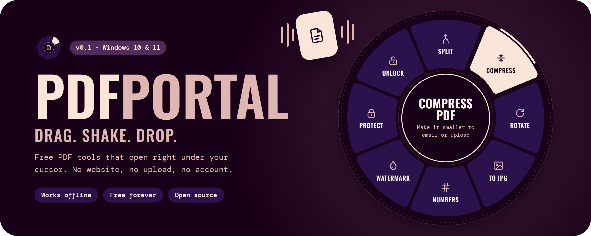
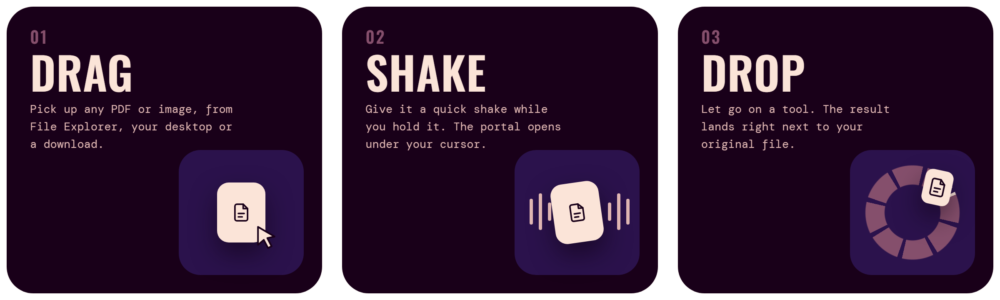
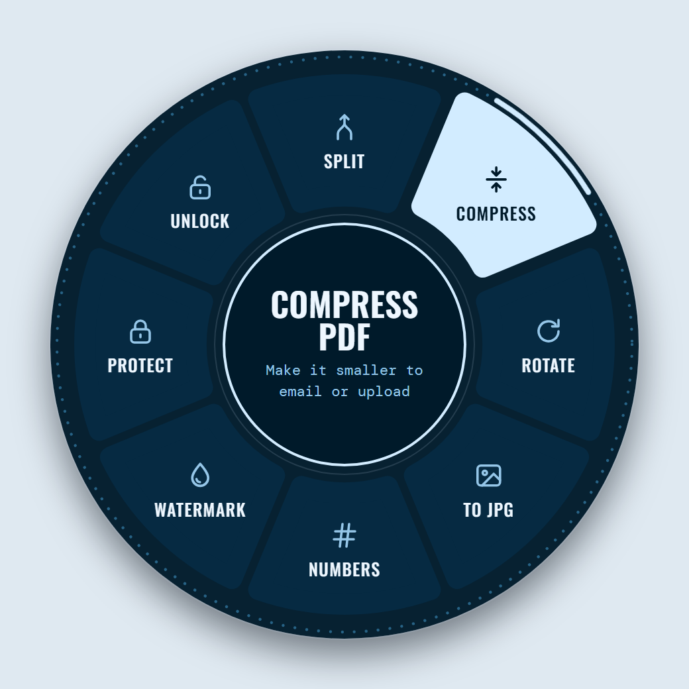
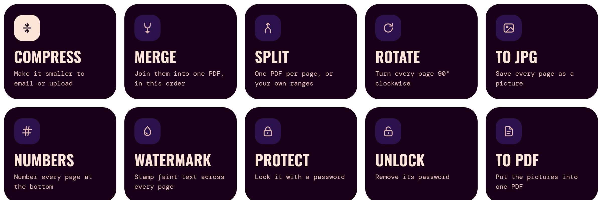
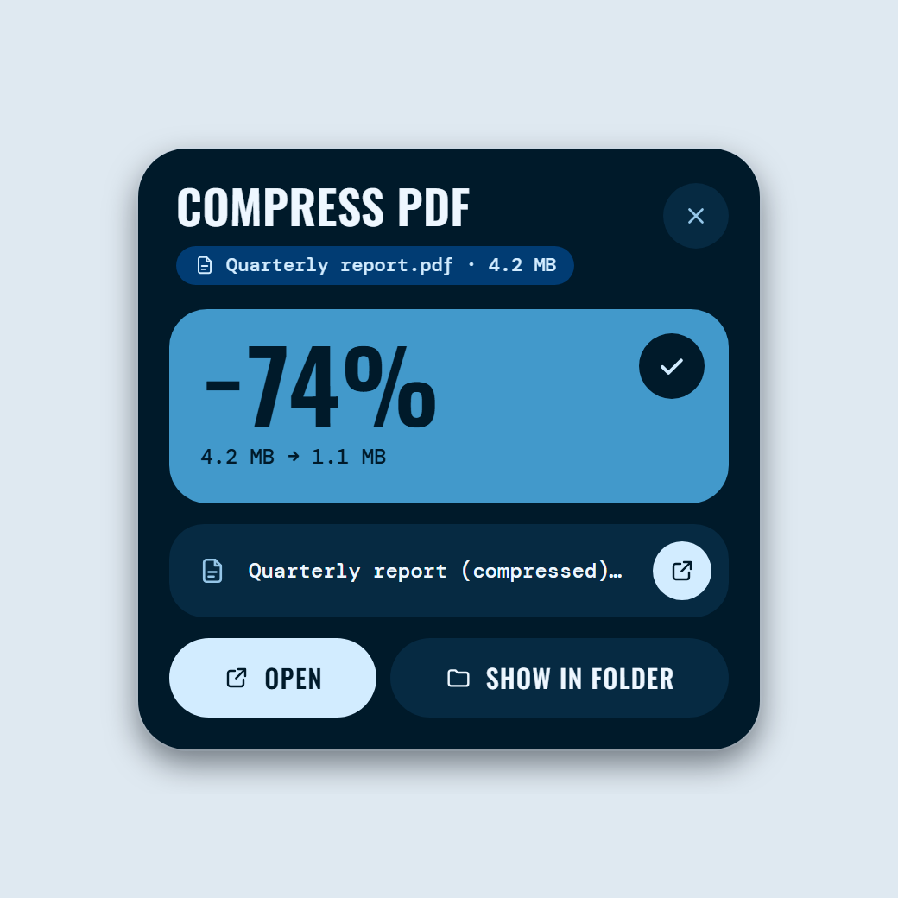
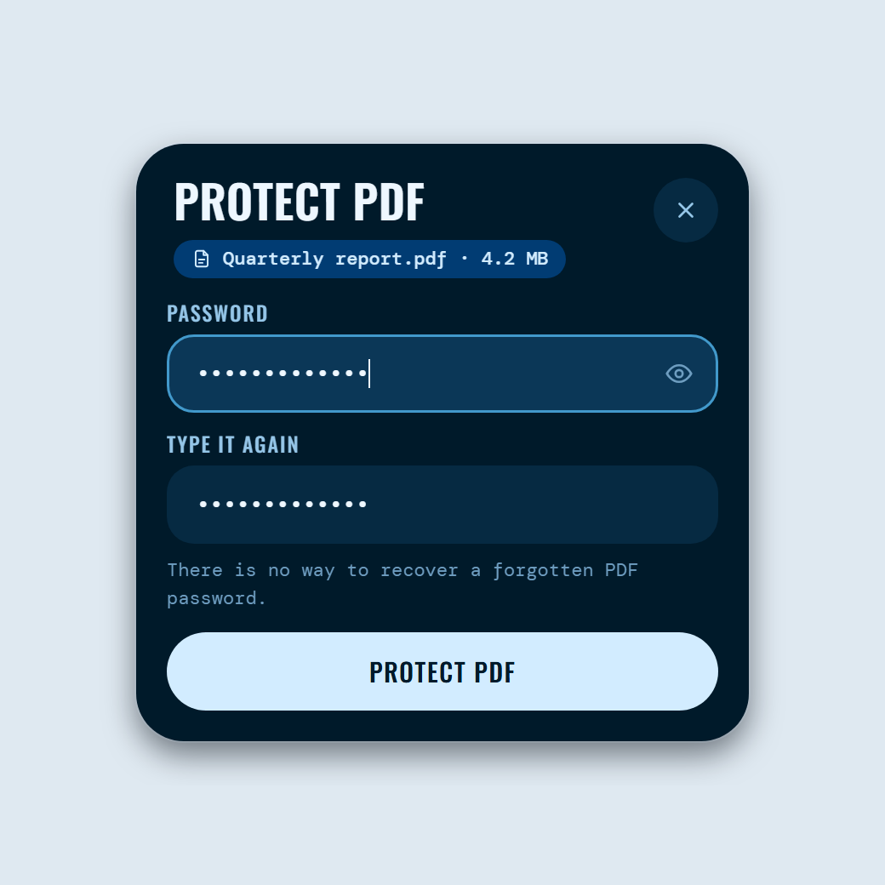
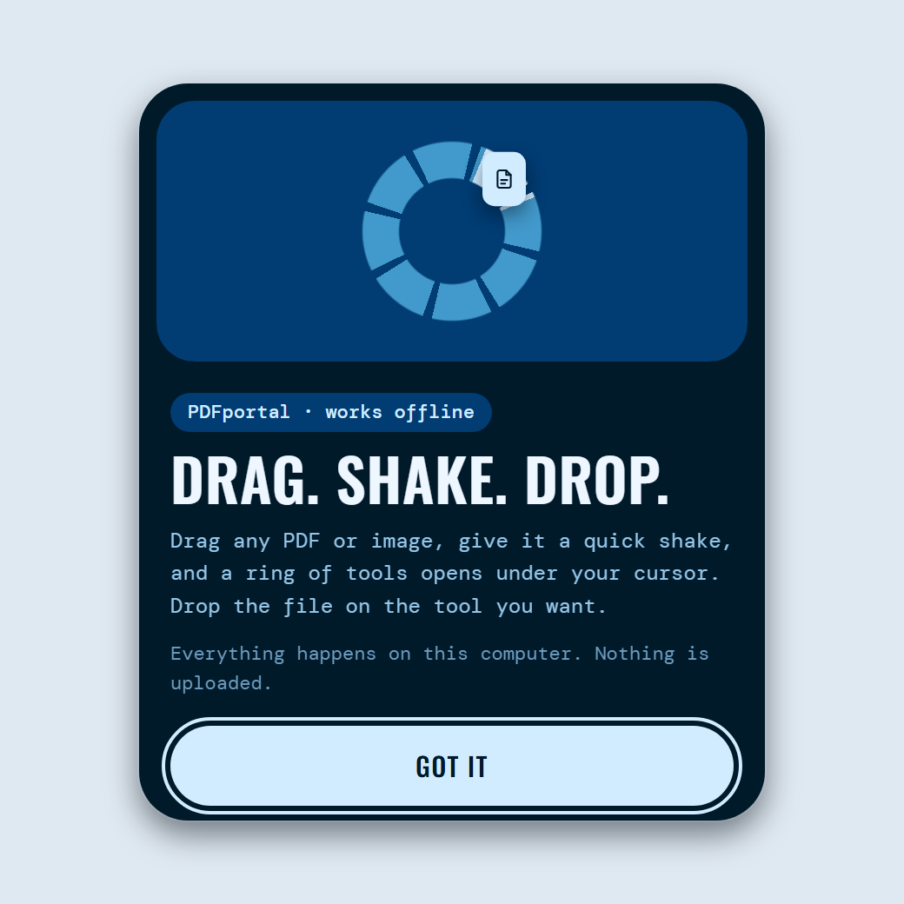
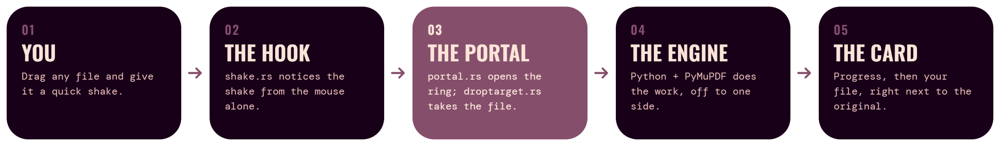

<p align="center">
  
</p>

<p align="center">
  <a href="LICENSE"></a>
  
  
  
</p>

<p align="center">
  <a href="https://github.com/Shivanshxsharma/pdfportal/releases/latest/download/PDFportal-Setup.exe"></a>
</p>

<p align="center">
  <a href="#how-it-works"><b>How it works</b></a> &nbsp;·&nbsp;
  <a href="#the-tools"><b>The tools</b></a> &nbsp;·&nbsp;
  <a href="#install"><b>Install</b></a> &nbsp;·&nbsp;
  <a href="#under-the-hood"><b>Under the hood</b></a> &nbsp;·&nbsp;
  <a href="#roadmap"><b>Roadmap</b></a>
</p>

<br>

## PDF tools, one gesture away

Most PDF tools make you go to them: open a website, upload your file, wait,
download it again. **PDFportal comes to you.**

Drag any PDF, give it a quick shake, and a ring of tools opens right where
your cursor is. Drop the file on the one you want. The ring becomes a small
card that shows the progress, then hands you the result. That's the whole app.

Everything happens on your computer. Your files never leave it.

<br>

## How it works

<p align="center">
  
</p>

<p align="center">
  
</p>

The ring only shows tools that fit what you're holding. One PDF gets eight
tools. Several PDFs get **Merge**. Images get **To PDF**. Move onto a tool and
the centre tells you what it will do. Changed your mind? Let go in the middle.

<br>

## The tools

<p align="center">
  
</p>

**Compress** shrinks oversized images and tidies the file. **Merge** joins
PDFs, and images, in the order you dragged them. **Split** makes one PDF per
page, or your own ranges like `1-3, 5, 8-`. **Protect** locks a PDF with
AES-256. **Unlock** removes a password or a PDF's restrictions.

<p align="center">
  
  &nbsp;
  
  &nbsp;
  
</p>

<br>

## Made to feel calm

- **Offline by design.** No servers, no uploads, no tracking. It works on a plane.
- **Nothing is overwritten.** Results land next to the original:
  `report.pdf` → `report (compressed).pdf`.
- **Instant.** The portal is loaded and waiting, so it opens the moment you shake.
- **Honest results.** If a PDF can't get any smaller, PDFportal says so
  instead of making a bigger copy.
- **Locks stay locked.** Compress, rotate, number or watermark a protected
  PDF and the result is still protected.
- **Free, for good.** Open source under the AGPL. No ads, no limits, no
  watermark on your files.

<br>

## Install

1. Download **[PDFportal-Setup.exe](https://github.com/Shivanshxsharma/pdfportal/releases/latest/download/PDFportal-Setup.exe)**
   (23.5 MB) from the [latest release](https://github.com/Shivanshxsharma/pdfportal/releases/latest).
2. Run it. It needs no admin rights: it installs just for you and adds
   PDFportal to the Start menu.
3. PDFportal starts in the tray, next to the clock, and shows you how it works.

Everything it needs is inside the installer, Python and the PDF engine
included; there's nothing else to install. It runs on Windows 10 and 11
(64-bit).

> [!NOTE]
> PDFportal isn't code-signed yet, so Windows may say *"Windows protected
> your PC"* the first time. Click **More info**, then **Run anyway**. Each
> release lists the installer's SHA-256 checksum, so you can check your
> download is the real one: `Get-FileHash PDFportal-Setup.exe` in PowerShell.

There's no main window. Right-click the tray icon for **How to use
PDFportal**, **Pause the shake gesture**, **Start with Windows** and
**Quit**. To uninstall, open **Settings → Apps → Installed apps →
PDFportal → Uninstall**.

### Build from source

You need Windows 10 or 11, [Rust](https://rustup.rs),
[Node.js](https://nodejs.org) 18+ and [Python](https://www.python.org) 3.11+.

```powershell
git clone https://github.com/Shivanshxsharma/pdfportal.git
cd pdfportal
npm install
npm run fonts

cd engine
py -3 -m venv .venv
.venv\Scripts\pip install -r requirements.txt
cd ..

cargo build --release --manifest-path src-tauri/Cargo.toml
src-tauri\target\release\pdfportal.exe
```

For development, `npx tauri dev` runs it with a console for the logs.
`npm run installer` builds the installer itself: it freezes the engine,
tests the frozen copy, and writes `PDFportal-Setup.exe` with its SHA-256.

<br>

## Under the hood

<p align="center">
  
</p>

- **[`src-tauri/`](src-tauri/src)**, the desktop app (Rust, [Tauri 2](https://tauri.app)).
  Windows doesn't tell apps when a drag starts, so a low-level mouse hook
  watches for the shake. The portal windows wait in a small pool so the ring
  opens instantly, and a plain native window laid over the ring receives the file.
- **[`src/`](src)**, the interface: plain HTML, CSS and JavaScript, no
  framework. `ring.js` draws the ring, `card.js` the cards, `app.js` ties
  them together.
- **[`engine/`](engine)**, the PDF engine (Python,
  [PyMuPDF](https://pymupdf.readthedocs.io)). One process per job: the job
  goes in as JSON, progress comes back as JSON lines, so a damaged PDF can
  only fail its own job.
- **[`scripts/`](scripts)**: the fonts, the icon, the pictures in this README,
  and a real drag-and-drop test.

The code is written to be read: every file opens with what it does, and the
comments explain why.

<br>

## Roadmap

- [x] Ten everyday tools: compress, merge, split, rotate, to JPG, numbers, watermark, protect, unlock, to PDF
- [x] An installer with the engine built in, and releases here on GitHub
- [ ] OCR, so scanned PDFs become searchable
- [ ] Sign, add text and images, redact, crop
- [ ] PDF/A, repair, compare
- [ ] Word, Excel and PowerPoint to PDF and back (LibreOffice)

<br>

## Contributing

Ideas, bug reports and pull requests are welcome. Before you open a pull
request, run the tests:

```powershell
npm test                                               # the PDF engine
cargo test --lib --manifest-path src-tauri/Cargo.toml  # the shake detector
```

`scripts/e2e-drag.ps1` tests the whole app with a real Windows drag. It
moves your mouse for a few seconds, so hands off while it runs.

<br>

## License

PDFportal is free software under the
[GNU Affero General Public License v3.0](LICENSE) or later.

It stands on [Tauri](https://tauri.app) (MIT/Apache-2.0) and
[PyMuPDF](https://github.com/pymupdf/PyMuPDF) (AGPL-3.0). The fonts are
[Oswald](https://github.com/googlefonts/OswaldFont) and
[DM Mono](https://github.com/googlefonts/dm-mono), both under the SIL Open
Font License.

<br>

<p align="center">
  
  <br>
  <sub>Made by <a href="https://github.com/Shivanshxsharma">Shivansh Sharma</a></sub>
</p>
